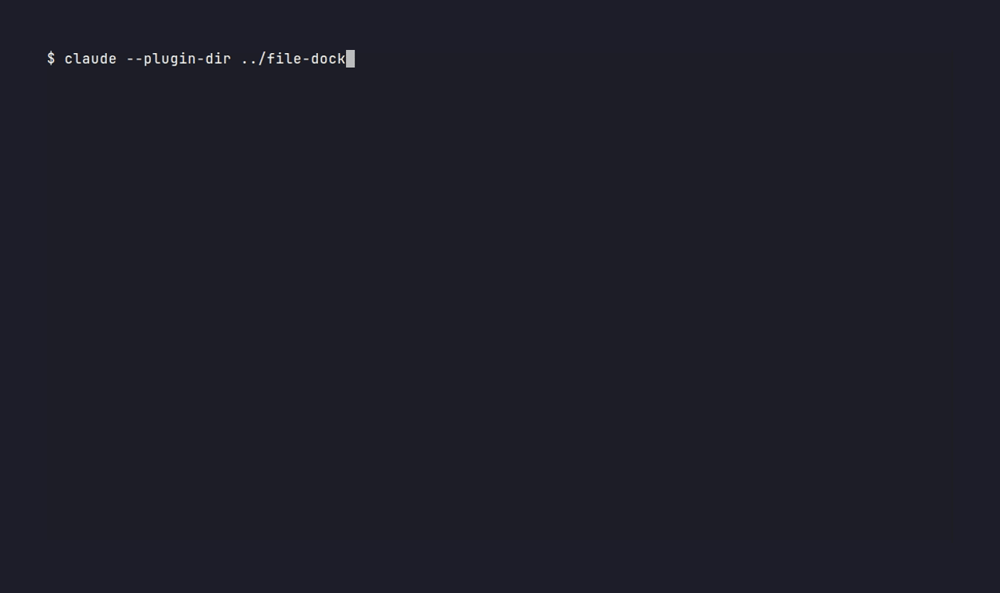

# file-dock

**Claude가 말한 경로와 붙여넣은 이미지가 FileDock 패널에 쌓입니다. 누르면 그 PC의 기본 프로그램이나 파일 탐색기로 바로 열리고, 항목마다 메모를 남길 수 있습니다.**

[마켓플레이스](../../README.md) · [플러그인 소스](.)



Claude Code [mods](https://code.claude.com/docs/en/plugins/mods/)로 만든 플러그인입니다. Claude Code 2.1.287 이상이 필요합니다.

## 설치

```text
/plugin marketplace add Changroro/plugins
/plugin install file-dock@changroro
/reload-plugins
```

## 기록 패널

입력창 위 `FileDock` 버튼을 누르거나 `/file-dock`을 입력하면 대화 옆에 기록 패널이 열립니다. 버튼을 다시 누르면 닫힙니다. 모든 세션과 프로젝트에서 나온 폴더·문서·이미지가 최신순으로 쌓이고, 세션을 닫아도 남습니다.

- 파일 이름을 누르면 기본 프로그램이나 파일 탐색기로 열립니다.
- `메모`를 누르고 내용을 쓴 뒤 Enter를 누르면 그 자리에 메모가 표시됩니다. 메모가 여러 개면 최신 메모가 버튼에 보이고 이전 메모는 그 아래에 남습니다.
- 같은 경로가 다시 나오면 메모를 유지한 채 맨 위로 올라옵니다.

터미널 폭이 110칸 이상인 전체화면 모드에서 오른쪽에 붙고, 그 밖에는 입력창 위에 열립니다. 붙여넣은 이미지는 임시 폴더 원본을 가리키므로, 원본이 지워지면 기록은 남아도 열리지 않습니다.

SSH로 접속한 PC에서는 파일이 그 PC에서 열리므로, 알림이 떠도 내 화면에는 열리지 않을 수 있습니다. 기록은 PC별로 따로 쌓입니다.

## 기록되는 경로

| 구분 | 대상 | 기록 시점 |
|---|---|---|
| 나 | 프롬프트로 보낸 이미지(`[Image #1]`) | 보낸 뒤 |
| 나 | 프롬프트에 적은 파일·폴더 경로 | 보낼 때 |
| Claude | 답변에 나온 파일·폴더 경로, 그 턴에 Claude가 Write·Edit로 만든 파일 | 답변이 끝날 때 |

백그라운드 작업 알림이나 `/` 명령은 기록하지 않습니다.

절대 경로, 상대 경로, `~/…`, Windows `C:\…`, `file://…`, 따옴표·백틱·굵게 표시 안의 경로를 인식합니다. 실제로 존재하는 파일과 폴더만 기록됩니다. 파일은 문서·이미지·영상·음성 확장자(pdf, hwp, docx, pptx, xlsx, md, png, jpg, mp4 등)만 대상으로 하고, 코드 파일은 기록하지 않습니다.

## 여는 방법

패널의 파일 이름을 클릭합니다. 성공하면 `📂 이름 열었습니다` 알림이 뜹니다.

| OS | 여는 명령 |
|---|---|
| Linux | `xdg-open` |
| macOS | `open` |
| Windows | `rundll32 url.dll,FileProtocolHandler` |

## 접근 범위

- 읽기: 경로가 실제로 있는지와 종류(파일·폴더), Claude Code가 붙여넣은 이미지를 두는 임시 폴더 목록, 입력창 내용(붙여넣은 이미지 번호 확인용)
- 실행: OS 판별용 `uname -s`, `id -u`, 그리고 버튼을 눌렀을 때 위의 여는 명령
- 쓰기: 기록과 메모를 Claude Code의 mod 저장소(`~/.claude/plugins/store/`)에 저장
- 네트워크·모델 호출: 없음

## 알려진 한계

- Linux에서 실제로 확인했고, macOS·Windows는 테스트로만 확인했습니다.
- 붙여넣은 이미지 위치는 Claude Code 내부 규칙(`<임시 폴더>/claude-<uid>/<프로젝트>/<세션>/images/`)을 따릅니다. Claude Code가 이 규칙을 바꾸면 이미지 버튼이 뜨지 않을 수 있습니다.
- 공백이 든 경로를 따옴표 없이 쓰면 공백 앞에서 끊겨 기록되지 않을 수 있습니다.

## 개발

```sh
claude plugin validate --strict plugins/file-dock
claude plugin test plugins/file-dock
claude --plugin-dir ./plugins/file-dock
```

데모 GIF는 `demo/file-dock.tape`를 [VHS](https://github.com/charmbracelet/vhs)로 녹화했습니다.
